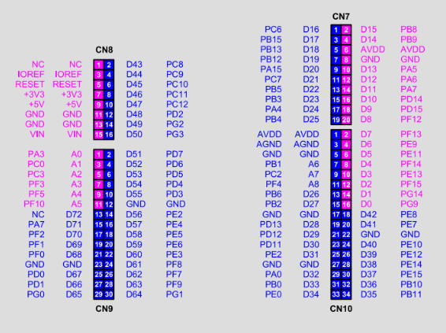

## BNO08X Pin Connection guide
|Front Pin Label|Back Pin Label|Nucleo Pin|                       
|---------------|--------------|----------|
|VCC            |VCC_3V3       |3.3V      |
|GND            |GND           |GND       |
|SCL            |SCL/SCK/RX    |PB10      |
|SDA            |SDA/MISO/TX   |PC2       |
|ADO            |ADDR/MOSI     |PC3       |
|CS             |CS            |PB8       |
|INT            |INT           |PB15      |
|RST            |RST           |PC6       |
|PS1            |PS1           |3.3V (Pull-up)|
|PS0            |PS0           |PB9        |

A picture of the nucleo board pinout for your reference

## Details
The IMU when connected will by default output the roll, pitch, and yaw readings. Pressing the reset button will also return the IMU to this format:

`Roll Pitch Yaw Acc=N`

A calibration mode has been set, where upon holding the blue user button down, then pressing and releasing reset, a message will display:

`Calibrating BNO080. Move the board through all orientations.
Press the blue USER button to finish and save to the sensor's flash.
Output: mag x, y, z (uTesla), mag accuracy, quat i, j, k, real, quat accuracy`

Wait for the red LD3 on the board to light up; this indicates that the board is ready for calibration. Release the blue user button to enter calibration mode. The green LD1 will light up when both the `mag accuracy` and `quat accuracy` readings are high. At this point, you can press and release the user button again to exit calibration mode.

### Output Format:
`mag x, y, z (uTesla)` : describe the magnetic field along each of the sensor's axes in micro Tesla

`mag accuracy` : describes the sensor's confidence in magnetic field reading

`quat i, j, k, real` : quaternion describing the sensor's orientation from the gyroscope and accelerometer readings (not outputted in calibration mode)

`quat accuracy` : describes the sensor's confidence in quaternion reading
